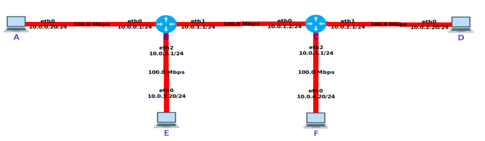

This scenario emulates the network topology shown below in CORE:



# Prerequisites

1. Install the CORE Docker container:
```
docker pull ghcr.io/coreemu/core-ubuntu:v9.2.1
```

2. Install dependencies:
```
pip install -r requirements.txt
```

# How to run scenario

Inside the CORE container:

1. Run `core-cleanup`.
2. Run the CORE GUI (`core-gui`), open `topology.xml` and start the session.
3. Run `/opt/core/venv/bin/python3 -u scenario.py > output.txt`
4. Stop the session.

This will dump the terminal output to `output.txt`.

# How to create the plots


